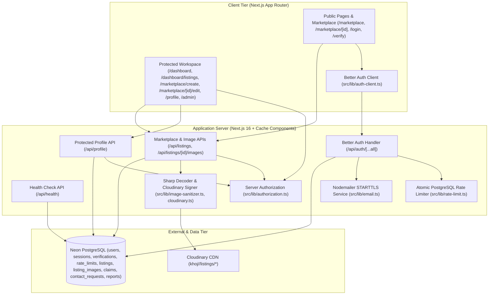

# Khoj

> **Find it. Sell it. Reclaim it.**

A community marketplace to buy and sell pre-owned items, report lost belongings, and reconnect people with what matters.

---

## 1. Project Overview

**Khoj** replaces chaotic group chats and unstructured classifieds with a dedicated marketplace and lost & found web application open to anyone with a valid email address (including local neighborhoods and college campuses).

What users can do as modules roll out:
- **Sign in passwordlessly (Implemented)** using any valid personal or institutional email via a 6-digit email OTP.
- **Manage profile & dashboard (Implemented)** with display name, general location, and optional campus/hostel info.
- **Buy and sell pre-owned items (Implemented)** with condition grading, Cloudinary signed image uploads, local meetup areas, `/marketplace` browse, `/marketplace/[id]` details, and `/dashboard/listings` owner controls (*live Neon/Cloudinary E2E testing deferred*).
- **Report lost & found items and submit ownership claims (Planned — Day 4)** before recovered belongings are handed over.
- **Search/filter UI & private contact requests (Planned — Day 4/5)** instead of broadcasting phone numbers.
- **Report suspicious activity (Planned — Day 6)** for administrator review.

> **Trust note:** Email OTP verification confirms control of an email inbox and enables account accountability, **not** personal identity verification or transaction guarantees.

---

## 2. Architecture



---

## 3. Current Implementation Status (Day 1 + Day 2 + Day 3 Code Complete)

| Component / Feature | Status | Notes |
| :--- | :--- | :--- |
| **Next.js 16 (Turbopack, Cache Components) & React 19** | Implemented | App Router, `<Suspense>` streaming, scoped `next/image` Cloudinary `remotePatterns` |
| **Tailwind CSS v4 & shadcn/ui** | Implemented | Primary (`#0F172A`), Accent (`#059669`), Background (`#F8FAFC`), Surface (`#FFFFFF`) |
| **Prisma 7 & Neon Driver Adapter** | Implemented | `@prisma/adapter-neon` singleton (`DATABASE_URL` runtime, `DIRECT_URL` CLI) |
| **Database Schema & Migrations** | Applied | `20261126212211_init` + `20261127110932_add_authentication` |
| **Better Auth + 6-Digit Email OTP** | Implemented | Passwordless only, HMAC-SHA256 keyed OTP storage, 5-min expiry, max 3 attempts |
| **PostgreSQL Atomic Rate Limiting** | Implemented | `60s` resend cooldown, `5/hr/email`, `10/hr/IP` send, `20/hr/IP` verify |
| **Gmail SMTP Transport (STARTTLS 587)** | Implemented | Live email delivery pending manual verification |
| **Marketplace CRUD & Listing Services** | Implemented | `SALE`-scoped APIs, `.strict()` Zod schemas, `Serializable` ownership/status guards |
| **Cloudinary Signed Uploads & Sharp Validation** | Implemented | Signature/dimension/25 MP bomb check, full pixel decode + EXIF strip, `413` bounded stream |
| **Marketplace UI (`/marketplace`, `/[id]`, `create`, `edit`, `/dashboard/listings`)** | Implemented | Public browse & gallery, owner workspace, soft delete, refresh recovery draft |
| **Automated Test Suite (Vitest)** | Passing (Mocked) | Mocks Prisma, Better Auth, Nodemailer, and Cloudinary |
| **Live Neon / Cloudinary / SMTP E2E Testing** | Deferred | Tracked in [Day 3 Testing Checklist](file:///Users/Saswata007/Developer/Khoj/docs/DAY3_TESTING_CHECKLIST.md) |
| **Lost & Found, Ownership Claims & Filter UI** | Planned | Scheduled for Day 4 |
| **Buyer-Seller Contact Requests** | Planned | Scheduled for Day 5 |
| **Moderation & Suspicious Activity Reports** | Planned | Scheduled for Day 6 |
| **Production Deployment (Vercel)** | Planned | Scheduled for Day 7 |

---

## 4. Known Technical Limitations & Deferred Testing

- **Live End-to-End Integration Deferred:** Automated tests mock PostgreSQL, Better Auth, SMTP, and Cloudinary. Live OTP email delivery, Neon DB persistence, and real Cloudinary uploads/deletions have **not** been executed yet; follow `docs/DAY3_TESTING_CHECKLIST.md` before launch.
- **Duplicate Listings & Refresh Recovery:** Client `inFlightRef`, `createdListingId` state, and tab-scoped `sessionStorage` recovery prevent double clicks and single-tab refresh duplicates during partial image upload failures, but durable cross-device/lost-response idempotency requires a future `idempotencyKey` DB column/unique index.
- **Partial Publishing Visibility:** Because the schema does not have a `DRAFT` status, listings enter `ACTIVE` visibility as soon as `POST /api/listings` succeeds, prior to queued photo upload completion.
- **Orphan Remote Assets:** Transient Cloudinary destroy errors are logged safely without failing DB updates; periodic reconciliation against `listing_images` is required in operations.
- **Unapplied Schema Proposals:** `idempotencyKey`, `isNegotiable`, and compound marketplace index are documented as deferred migrations in `docs/DATABASE.md`.

---

## 5. Technology Stack

- **Framework:** Next.js 16.4.6 (App Router, Turbopack, Cache Components)
- **Language:** TypeScript 5 (strict)
- **Auth:** Better Auth 1.7.28 (`emailOTP` plugin, HMAC-SHA256 OTP hashing, `prismaAdapter`, `nextCookies`)
- **Email:** Nodemailer (SMTP port 587 STARTTLS)
- **Media & Image Processing:** Cloudinary Node.js SDK + `sharp` (via Next.js runtime)
- **Styling:** Tailwind CSS 4 + shadcn/ui + Base UI + Lucide React
- **Database:** Neon PostgreSQL + Prisma 7.10.1 + `@prisma/adapter-neon`
- **Validation & Testing:** Zod 4.6, Vitest 5.1

---

## 6. Local Setup

```bash
git clone https://github.com/Saswata2006/Khoj.git
cd Khoj
npm install
cp .env.example .env
```

Configure `.env` with your Neon PostgreSQL (`DATABASE_URL`, `DIRECT_URL`), Better Auth (`BETTER_AUTH_SECRET`, `BETTER_AUTH_URL`), and SMTP (`SMTP_HOST`, `SMTP_PORT`, `SMTP_USER`, `SMTP_PASS`, `EMAIL_FROM`) values.

```bash
npx prisma migrate deploy
npx prisma generate
npm run dev
```

---

## 7. Commands

| Command | Description |
| :--- | :--- |
| `npm run dev` | Starts local Next.js dev server |
| `npm run build` | Builds production bundle |
| `npm run lint` | Runs ESLint |
| `npm run test` | Runs Vitest suite |
| `npx tsc --noEmit` | Runs TypeScript type check |
| `npx prisma validate` | Validates Prisma schema |

---

## 8. Documentation

- [System Architecture](file:///Users/Saswata007/Developer/Khoj/docs/ARCHITECTURE.md)
- [Database Schema & Migrations](file:///Users/Saswata007/Developer/Khoj/docs/DATABASE.md)
- [Implementation Roadmap](file:///Users/Saswata007/Developer/Khoj/docs/ROADMAP.md)
- [Day 2 Backend Handoff](file:///Users/Saswata007/Developer/Khoj/docs/DAY2_BACKEND_HANDOFF.md)
- [Day 3 Marketplace Handoff](file:///Users/Saswata007/Developer/Khoj/docs/DAY3_MARKETPLACE_HANDOFF.md)
- [Day 3 Live Testing Checklist (Deferred)](file:///Users/Saswata007/Developer/Khoj/docs/DAY3_TESTING_CHECKLIST.md)
