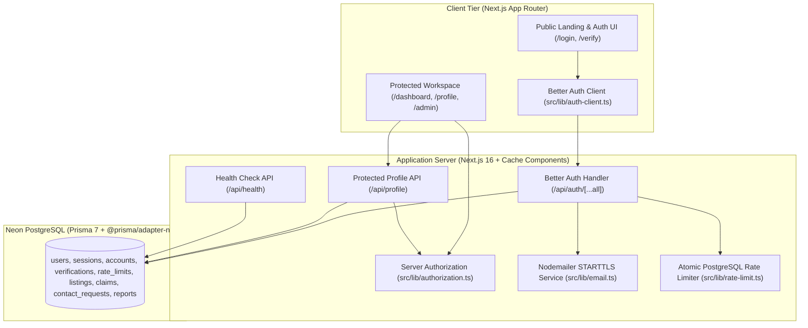

# Khoj

> **Find it. Sell it. Reclaim it.**

A community marketplace to buy and sell pre-owned items, report lost belongings, and reconnect people with what matters.

---

## 1. Project Overview

**Khoj** replaces chaotic group chats and unstructured classifieds with a dedicated marketplace and lost & found web application open to anyone with a valid email address (including local neighborhoods and college campuses).

What users can do as modules roll out:
- **Sign in passwordlessly (Implemented)** using any valid personal or institutional email via a 6-digit email OTP.
- **Manage profile & dashboard (Implemented)** with display name, general location, and optional campus/hostel info.
- **Buy and sell pre-owned items (Planned)** with clear condition grading and local meetup locations.
- **Report lost & found items and submit ownership claims (Planned)** before recovered belongings are handed over.
- **Request seller contact details privately (Planned)** instead of broadcasting phone numbers.
- **Report suspicious activity (Planned)** for administrator review.

> **Trust note:** Email OTP verification confirms control of an email inbox and enables account accountability, **not** personal identity verification or transaction guarantees.

---

## 2. Architecture



---

## 3. Current Implementation Status (Day 1 + Day 2 Complete)

| Component / Feature | Status | Notes |
| :--- | :--- | :--- |
| **Next.js 16 (Turbopack, Cache Components) & React 19** | Implemented | App Router, `<Suspense>` streaming for session routes |
| **Tailwind CSS v4 & shadcn/ui** | Implemented | Primary (`#0F172A`), Accent (`#059669`), Background (`#F8FAFC`), Surface (`#FFFFFF`) |
| **Prisma 7 & Neon Driver Adapter** | Implemented | `@prisma/adapter-neon` singleton in `src/lib/prisma.ts` |
| **Database Schema & Migrations** | Applied | `20261126212211_init` + `20261127110932_add_authentication` |
| **Better Auth + 6-Digit Email OTP** | Implemented | Passwordless only, 5-min expiry, max 3 attempts, 7-day DB sessions |
| **PostgreSQL Atomic Rate Limiting** | Implemented | `60s` resend cooldown, `5/hr/email`, `10/hr/IP` send, `20/hr/IP` verify |
| **Gmail SMTP Transport (STARTTLS 587)** | Implemented | `src/lib/email.ts` (live OTP email delivery not yet verified end-to-end) |
| **Login (`/login`) & OTP Verify (`/verify`)** | Implemented | 6-box numeric OTP input, paste support, 60s countdown |
| **Protected `/dashboard`, `/profile`, `/admin`** | Implemented | Server-side session & `ADMIN` role enforcement |
| **Session-Aware Navbar & Logout** | Implemented | Desktop & mobile navigation with initials and session invalidation |
| **Profile API (`/api/profile`)** | Implemented | Zod allowlisted `name`, `location`, `hostelBlock` updates |
| **Health Check API (`/api/health`)** | Implemented | `SELECT 1` connectivity check |
| **Automated Test Suite (Vitest)** | Implemented | Unit & SSR tests with mocked DB/auth/SMTP (no live email sending) |
| **Marketplace Listings CRUD & Cloudinary** | Planned | Scheduled for Day 3 |
| **Lost & Found Claims Workflow** | Planned | Scheduled for Day 4 |
| **Search, Filters & Contact Requests** | Planned | Scheduled for Day 5 |
| **Moderation & Suspicious Activity Reports** | Planned | Scheduled for Day 6 |
| **Production Deployment (Vercel)** | Planned | Scheduled for Day 7 |

---

## 4. Development Limitations & Pending Verification

- **Gmail SMTP (Development Only):** Configured for `smtp.gmail.com` on port `587` (`requireTLS: true`). Automated tests mock Nodemailer and **real OTP email delivery has not been verified end-to-end yet**. Rotate any previously exposed SMTP/Neon credentials before live testing.
- **OTP Storage Hashing:** `emailOTP` currently uses Better Auth's `storeOTP: "hashed"` (unkeyed SHA-256). See `docs/DAY2_BACKEND_HANDOFF.md` for details.
- **Migration Risk for Day 1 Data:** Applied migration `20261127110932_add_authentication` drops/recreates `emailVerified` and casts `UserRole`; see `docs/DATABASE.md` before applying to non-empty legacy databases.

---

## 5. Technology Stack

- **Framework:** Next.js 16.4.6 (App Router, Turbopack, Cache Components)
- **Language:** TypeScript 5 (strict)
- **Auth:** Better Auth 1.7.28 (`emailOTP` plugin, `prismaAdapter`, `nextCookies`)
- **Email:** Nodemailer (SMTP port 587 STARTTLS)
- **Styling:** Tailwind CSS 4 + shadcn/ui + Base UI + Lucide React
- **Database:** Neon PostgreSQL + Prisma 7.10.1 + `@prisma/adapter-neon`
- **Validation & Testing:** Zod 4.6, Vitest 5.1

---

## 6. Local Setup

```bash
git clone https://github.com/Saswata2006/Khoj.git
cd Khoj
npm install
cp .env.example .env
```

Configure `.env` with your Neon PostgreSQL (`DATABASE_URL`, `DIRECT_URL`), Better Auth (`BETTER_AUTH_SECRET`, `BETTER_AUTH_URL`), and SMTP (`SMTP_HOST`, `SMTP_PORT`, `SMTP_USER`, `SMTP_PASS`, `EMAIL_FROM`) values.

```bash
npx prisma migrate deploy
npx prisma generate
npm run dev
```

---

## 7. Commands

| Command | Description |
| :--- | :--- |
| `npm run dev` | Starts local Next.js dev server |
| `npm run build` | Builds production bundle |
| `npm run lint` | Runs ESLint |
| `npm run test` | Runs Vitest suite |
| `npx tsc --noEmit` | Runs TypeScript type check |
| `npx prisma validate` | Validates Prisma schema |

---

## 8. Documentation

- [System Architecture](file:///Users/Saswata007/Developer/Khoj/docs/ARCHITECTURE.md)
- [Database Schema & Migrations](file:///Users/Saswata007/Developer/Khoj/docs/DATABASE.md)
- [Implementation Roadmap](file:///Users/Saswata007/Developer/Khoj/docs/ROADMAP.md)
- [Day 2 Backend Handoff](file:///Users/Saswata007/Developer/Khoj/docs/DAY2_BACKEND_HANDOFF.md)
