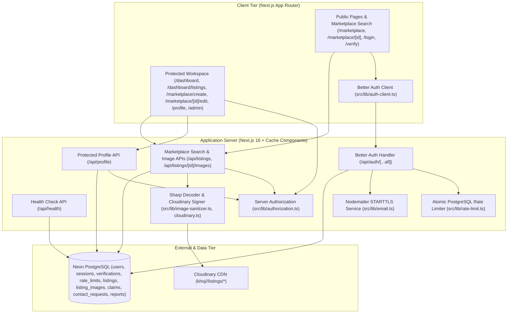

# Khoj

[](https://github.com/Saswata2006/Khoj/actions/workflows/ci.yml)

> **Find it. Sell it. Reclaim it.**

A community marketplace to buy and sell pre-owned items, report lost belongings, and reconnect people with what matters.

---

## 1. Project Overview

**Khoj** replaces chaotic group chats and unstructured classifieds with a dedicated marketplace and lost & found web application open to anyone with a valid email address (including local neighborhoods and college campuses).

What users can do across implemented and planned modules:
- **Sign in passwordlessly (Implemented)** using any valid personal or institutional email via a 6-digit email OTP.
- **Manage profile & dashboard (Implemented)** with display name, general location, and optional campus/hostel info.
- **Buy, sell, and discover pre-owned items (Implemented)** with `/marketplace` keyword search (`q`), category/condition/INR price/location filters, server sorting, Cloudinary signed image uploads, `/marketplace/[id]` details, and `/dashboard/listings` owner controls (*live Neon/Cloudinary E2E testing deferred*).
- **Automated CI Quality Gates (Implemented)** via GitHub Actions ([Khoj CI](file:///Users/Saswata007/Developer/Khoj/.github/workflows/ci.yml)) running schema, TypeScript, ESLint, Vitest, and Next.js production builds on pull requests and branch pushes (*remote workflow status reflects runs once pushed to GitHub*).
- **Private buyer-seller contact requests (Planned — Day 5)** instead of broadcasting phone numbers.
- **Lost & Found item reporting and ownership claims (Planned — Day 6)** before recovered belongings are handed over.
- **Admin moderation, live testing & deployment (Planned — Day 7)** for suspicious activity reports and launch verification.

> **Trust note:** Email OTP verification confirms control of an email inbox and enables account accountability, **not** personal identity verification or transaction guarantees.

---

## 2. Architecture



---

## 3. Current Implementation Status (Day 1 – Day 4 Code Complete)

| Component / Feature | Status | Notes |
| :--- | :--- | :--- |
| **Next.js 16 (Turbopack, Cache Components) & React 19** | Implemented | App Router, `<Suspense>` streaming, scoped `next/image` Cloudinary `remotePatterns` |
| **Tailwind CSS v4 & shadcn/ui** | Implemented | Primary (`#0F172A`), Accent (`#059669`), Background (`#F8FAFC`), Surface (`#FFFFFF`), Base UI `Sheet` |
| **Prisma 7 & Neon Driver Adapter** | Implemented | `@prisma/adapter-neon` singleton (`DATABASE_URL` runtime, `DIRECT_URL` CLI) |
| **Database Schema & Migrations** | Applied | `20261126212211_init` + `20261127110932_add_authentication` |
| **Better Auth + 6-Digit Email OTP** | Implemented | Passwordless only, HMAC-SHA256 keyed OTP storage, 5-min expiry, max 3 attempts |
| **PostgreSQL Atomic Rate Limiting** | Implemented | `60s` resend cooldown, `5/hr/email`, `10/hr/IP` send, `20/hr/IP` verify |
| **Gmail SMTP Transport (STARTTLS 587)** | Implemented | Live email delivery pending manual verification |
| **Marketplace CRUD & Listing Services** | Implemented | `SALE`-scoped APIs, `.strict()` Zod schemas, `Serializable` ownership/status guards |
| **Cloudinary Signed Uploads & Sharp Validation** | Implemented | Explicit runtime `sharp` (`0.35.5`), 25 MP bomb check, EXIF strip, `413` bounded stream |
| **Marketplace Search, Filters, Sorting & Query Optimization** | Implemented | `q`/category/condition/INR price/location URL state, responsive Sheet/Sidebar, card projection optimization |
| **PostgreSQL Search Index Proposal & Benchmarks** | Proposal Only | Review-only SQL in `docs/DAY4_INDEX_MIGRATION_PROPOSAL.sql`; benchmarking & approval pending |
| **GitHub Actions CI (`.github/workflows/ci.yml`)** | Configured | Ready for remote runs on push/PR; verified locally using CI-safe placeholders |
| **Automated Test Suite (Vitest)** | Passing (Mocked) | 14 test files, 206 tests mocking Prisma, Better Auth, Nodemailer, Cloudinary (`sharp` on synthetic buffers) |
| **Live Neon / Cloudinary / SMTP E2E Testing** | Deferred | Tracked in [Day 3 Testing Checklist](file:///Users/Saswata007/Developer/Khoj/docs/DAY3_TESTING_CHECKLIST.md) |
| **Day 5: Private Buyer-Seller Contact Requests** | Planned | Private inquiry & consent workflow |
| **Day 6: Lost & Found & Ownership Claims** | Planned | Dedicated `LOST` / `FOUND` workflows & claim review |
| **Day 7: Admin Moderation, Live Testing & Deployment** | Planned | Flagged listing review, live E2E verification, and production deploy |

---

## 4. Known Technical Limitations & Deferred Verification

- **Live End-to-End Integration Deferred:** Automated tests mock PostgreSQL, Better Auth, SMTP, and Cloudinary. Live OTP email delivery, Neon DB persistence, and real Cloudinary uploads/deletions have **not** been executed yet; follow `docs/DAY3_TESTING_CHECKLIST.md` before launch.
- **Database Index Approval & Benchmarking Pending:** [DAY4_INDEX_MIGRATION_PROPOSAL.sql](file:///Users/Saswata007/Developer/Khoj/docs/DAY4_INDEX_MIGRATION_PROPOSAL.sql) proposes partial composite B-tree and `pg_trgm` GIN indexes for active marketplace queries. No live `EXPLAIN (ANALYZE, BUFFERS)` benchmarks or DDL changes have been run or approved yet.
- **Concurrent Prisma Queries:** `Promise.all([findMany, count])` overlaps two separate Prisma/Neon queries concurrently to reduce wall-clock wait time vs sequential execution, rather than executing as a single combined SQL round trip.
- **Duplicate Listings & Refresh Recovery:** Client `inFlightRef`, `createdListingId` state, and tab-scoped `sessionStorage` recovery prevent double clicks and single-tab refresh duplicates during partial image upload failures, while durable cross-device idempotency requires a future `idempotencyKey` migration.
- **Orphan Remote Assets & Partial Visibility:** Listings become `ACTIVE` before image uploads finish (no `DRAFT` state yet), and transient Cloudinary delete failures require periodic asset reconciliation.

---

## 5. Technology Stack

- **Runtime:** Node.js `22.x` (`>=22.12.0 <23` via `package.json` `engines`, pinned `22.14.0` in CI)
- **Framework:** Next.js 16.4.6 (App Router, Turbopack, Cache Components)
- **Language:** TypeScript 5 (strict)
- **Auth:** Better Auth 1.7.28 (`emailOTP` plugin, HMAC-SHA256 OTP hashing, `prismaAdapter`, `nextCookies`)
- **Email:** Nodemailer (SMTP port 587 STARTTLS)
- **Media & Image Processing:** Cloudinary Node.js SDK + `sharp` (`0.35.5` runtime dependency)
- **Styling:** Tailwind CSS 4 + shadcn/ui + Base UI + Lucide React
- **Database:** Neon PostgreSQL + Prisma 7.10.1 + `@prisma/adapter-neon`
- **Validation & Testing:** Zod 4.6, Vitest 5.1

---

## 6. Continuous Integration (GitHub Actions)

The CI workflow is defined in [ci.yml](file:///Users/Saswata007/Developer/Khoj/.github/workflows/ci.yml) (`Khoj CI`).

### Triggers & Guardrails
- **Triggers:** `push` to `main`, `feat/**`, `fix/**`, and `chore/**`; `pull_request` targeting `main`.
- **Runner & Security:** `ubuntu-latest`, Node.js `22.14.0` with `actions/setup-node@v4` (`cache: "npm"`), `permissions: { contents: read }`, concurrency cancellation per ref, `timeout-minutes: 15`, and no deployment jobs or privileged `pull_request_target` triggers.

### Quality Gates (Strict Sequential Fail-Fast)
1. `npm ci` — clean deterministic dependency install (including Linux native `sharp` binaries via `package-lock.json`)
2. `npx prisma generate` — generates Prisma Client cleanly from `prisma/schema.prisma`
3. `npx prisma validate` — checks Prisma schema validity
4. `npx tsc --noEmit` — verifies strict TypeScript compilation
5. `npm run lint` — runs ESLint (`eslint-config-next`)
6. `npm run test` — runs Vitest unit, API contract, search UI, and SSR suites (including real `sharp` image buffer tests)
7. `npm run build` — validates full Next.js 16 production compilation and route generation

### Safe CI Environment Strategy
- CI runs with **non-sensitive placeholder variables only** (`DATABASE_URL`, `DIRECT_URL` pointing to `127.0.0.1:5432`, non-secret `BETTER_AUTH_SECRET` and 32+ char `OTP_HASH_SECRET` strings, `localhost` app URLs, `NEXT_TELEMETRY_DISABLED=1`).
- No `.env` file, Neon credentials, Gmail SMTP passwords, Cloudinary API keys, or production secrets exist in workflow files, and `NODE_ENV` is left unset at job level so `npm ci` installs `devDependencies`.
- **Note on remote status:** Local CI simulation passes, while GitHub Actions badge/status must be confirmed on GitHub after pushing this branch.

### Diagnosing Failing Checks
- **Prisma generate/validate fails:** Run `npx prisma validate` locally; verify `DIRECT_URL` placeholder format and check `prisma/schema.prisma` formatting.
- **Typecheck or ESLint fails:** Run `npx tsc --noEmit` and `npm run lint`; watch React 19 hook rules (`react-hooks/set-state-in-effect`) and Next.js 16 `<Suspense>` requirements.
- **Vitest fails:** Run `npm run test`; confirm tests remain self-contained with mocked Prisma/Auth/SMTP/Cloudinary and do not depend on private `.env` values.
- **Next.js build fails:** Run `npm run build` locally with clean `.next`; check that server-only modules keep `import "server-only"`, client components under `useSearchParams` or dynamic data sit inside `<Suspense>`, and outbound Google Fonts requests are reachable.

---

## 7. Local Setup & Verification Commands

```bash
git clone https://github.com/Saswata2006/Khoj.git
cd Khoj
npm ci
cp .env.example .env
```

Configure `.env` with your Neon PostgreSQL (`DATABASE_URL`, `DIRECT_URL`), Better Auth (`BETTER_AUTH_SECRET`, `OTP_HASH_SECRET`, `BETTER_AUTH_URL`), Gmail SMTP (`SMTP_*`, `EMAIL_FROM`), and Cloudinary (`CLOUDINARY_*`) development credentials before running live dev operations.

```bash
npx prisma migrate deploy
npx prisma generate
npm run dev
```

| Command | Description |
| :--- | :--- |
| `npm run dev` | Starts local Next.js dev server |
| `npx prisma generate` | Generates Prisma Client |
| `npx prisma validate` | Validates Prisma schema |
| `npx tsc --noEmit` | Runs TypeScript type check |
| `npm run lint` | Runs ESLint |
| `npm run test` | Runs Vitest suite |
| `npm run build` | Builds production bundle |
| `git diff --check` | Checks whitespace/conflict markers |

---

## 8. Documentation

- [System Architecture](file:///Users/Saswata007/Developer/Khoj/docs/ARCHITECTURE.md)
- [Database Schema & Migrations](file:///Users/Saswata007/Developer/Khoj/docs/DATABASE.md)
- [Implementation Roadmap](file:///Users/Saswata007/Developer/Khoj/docs/ROADMAP.md)
- [Day 2 Backend Handoff](file:///Users/Saswata007/Developer/Khoj/docs/DAY2_BACKEND_HANDOFF.md)
- [Day 3 Marketplace Handoff](file:///Users/Saswata007/Developer/Khoj/docs/DAY3_MARKETPLACE_HANDOFF.md)
- [Day 3 Live Testing Checklist (Deferred)](file:///Users/Saswata007/Developer/Khoj/docs/DAY3_TESTING_CHECKLIST.md)
- [Day 4 Search, Optimization & CI Handoff](file:///Users/Saswata007/Developer/Khoj/docs/DAY4_SEARCH_HANDOFF.md)
- [Day 4 Index Migration Proposal (Review-Only)](file:///Users/Saswata007/Developer/Khoj/docs/DAY4_INDEX_MIGRATION_PROPOSAL.sql)
