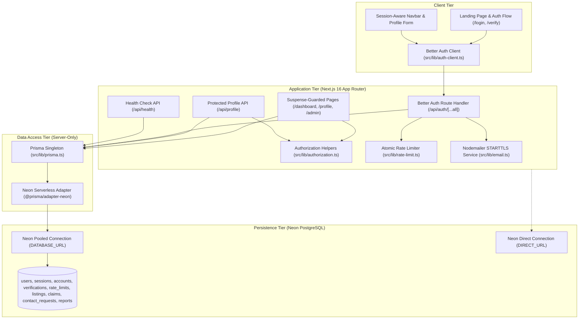

# Khoj — System Architecture

## 1. Architectural Overview

**Khoj** is a modular full-stack web application built with Next.js 16 (App Router, Turbopack, Cache Components), TypeScript, Better Auth, and Neon PostgreSQL via Prisma 7. It serves a public community marketplace and lost & found platform (supporting both local neighborhoods and campus communities) open to any valid email address.

---

## 2. Layered Architecture

### 2.1 Presentation & Cache Components (`src/components`, `src/app`)
- **Next.js 16 Cache Components:** Static shells prerender automatically while request-time session checks (`headers()` via `getCurrentUser()` / `requireAdmin()`) execute inside `<Suspense>` boundaries on `/login`, `/verify`, `/dashboard`, `/profile`, and `/admin`.
- **No Private Data Caching:** Private user dashboards and profile views are never wrapped in server `use cache`; every request resolves against live database-backed sessions.
- **UI Primitives:** Built with Tailwind CSS v4 tokens (`#0F172A`, `#059669`, `#F8FAFC`, `#FFFFFF`), shadcn/ui, Base UI, and Lucide icons.

### 2.2 Authentication & Authorization (`src/lib/auth.ts`, `src/lib/authorization.ts`)
- **Passwordless Email OTP:** Better Auth (`1.7.28`) with the `emailOTP` plugin (`otpLength: 6`, `expiresIn: 300`, `allowedAttempts: 3`, `storeOTP: "hashed"`, `resendStrategy: "rotate"`). Password sign-in, password reset, magic links, and email changes are disabled.
- **Sessions:** 7-day PostgreSQL database-backed sessions (`sessions` table) with `cookieCache` disabled so sign-out invalidates sessions immediately.
- **Authorization Helpers (`server-only`):** `getCurrentUser()`, `requireUser()` (401), and `requireAdmin()` (401/403). `User.role` has `input: false` in Better Auth and is excluded from `/api/profile` updates via Zod `.strict()`.
- **Open Redirect Prevention:** `sanitizeRedirectPath()` in `src/lib/auth-ui.ts` permits only safe relative paths and rejects external URLs, `//`, backslashes, and auth route loops.

### 2.3 Rate Limiting & Email (`src/lib/rate-limit.ts`, `src/lib/email.ts`)
- **Persistent Atomic Rate Limiting:** Uses PostgreSQL `INSERT ... ON CONFLICT ("key") DO UPDATE ... WHERE ... RETURNING` on `rate_limits` (`src/lib/rate-limit.ts`), connected to Better Auth's `rateLimit.customStorage` (IP limits) and `hooks.before` (60s cooldown + 5/hr per normalized email).
- **Email Delivery:** Nodemailer configured for Gmail SMTP on port `587` (`secure: false`, `requireTLS: true`). Live SMTP OTP delivery remains pending end-to-end verification in development; automated tests mock SMTP without sending real emails.

### 2.4 Data Access Tier (`src/lib/prisma.ts`, `prisma/`)
- **Server-Only Isolation:** Guarded by `import "server-only"`.
- **Dual-URL Config:** `DATABASE_URL` (pooled runtime queries) in `src/lib/prisma.ts`; `DIRECT_URL` (CLI migrations) in `prisma.config.ts`.
