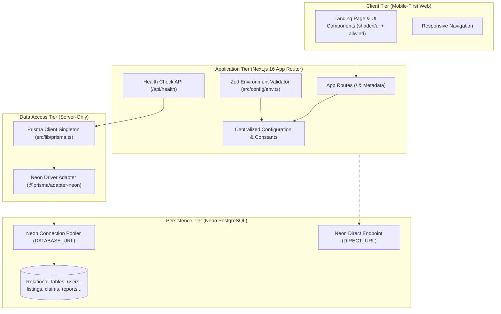

# Khoj — System Architecture

## 1. Architectural Overview

**Khoj** is designed as a modular, production-ready, full-stack application built upon Next.js App Router, TypeScript, and PostgreSQL (hosted on Neon Serverless). The architecture emphasizes strict type safety, zero database credential exposure, serverless-optimized connection pooling, and component modularity.

---

## 2. Layered Architecture

### 2.1 Presentation Layer (`src/components`, `src/app`)
- **Server Components by default**: Prerendered static shells for optimal initial paint performance and zero client bundle bloat.
- **Client Components (`"use client"` restricted)**: Used strictly when interactive state is required (e.g., mobile hamburger menu, interactive forms).
- **Design System**: Accessible primitives via shadcn/ui and Radix/Base UI, styled with Tailwind CSS v4 design tokens.
- **No Unstable Prerendering**: Strict adherence to Next.js 16 caching conventions with compile-time deterministic renders.

### 2.2 Configuration & Domain Layer (`src/config`, `src/constants`)
- **`site.ts`**: Centralized application metadata, branding, and navigation hierarchy.
- **`campus.ts`**: Institution-agnostic configuration for hostel blocks, campus policies, and email domain validation without hardcoded assumptions.
- **`env.ts`**: Zod-based runtime schema validation. Shields database secrets and allows clean builds in isolated environments.
- **`categories.ts`**: Strongly typed category structures, icons, and validation helpers mapped directly to Prisma enums.

### 2.3 Data Access Layer (`src/lib/prisma.ts`, `prisma/`)
- **Server-Only Enforcement**: Guarded by `import "server-only";` to ensure database credentials and client code never leak into browser bundles.
- **Development-Safe Singleton**: Prevents connection exhaustion in Node/Turbopack fast-refresh cycles by caching the instance on `globalThis`.
- **Neon Driver Adapter**: Leverages `@prisma/adapter-neon` over WebSocket/HTTP for ultra-low latency serverless transactions.
- **Dual-URL Strategy**:
  - `DATABASE_URL`: Runtime connection through Neon's connection pooler.
  - `DIRECT_URL`: Direct PostgreSQL connection used by Prisma CLI for migrations and DDL operations.

---

## 3. Security & Isolation Model

1. **Credential Isolation**: Database URLs, API tokens, and secrets are strictly isolated on the server. No secrets are prefixed with `NEXT_PUBLIC_`.
2. **Sanitized Error Boundaries**: API routes (including `/api/health`) catch errors and return uniform status payloads without leaking internal database error codes, hostnames, or schema details.
3. **Campus Boundary Verification**: Domain-level verification ensures only students with authorized institutional email domains can participate (planned for Day 2 Auth.js rollout).
4. **Relationship Invariant Enforcement**: Relational foreign keys and composite unique constraints (e.g. `[listingId, claimantId]`) enforce data integrity at the database engine level.
