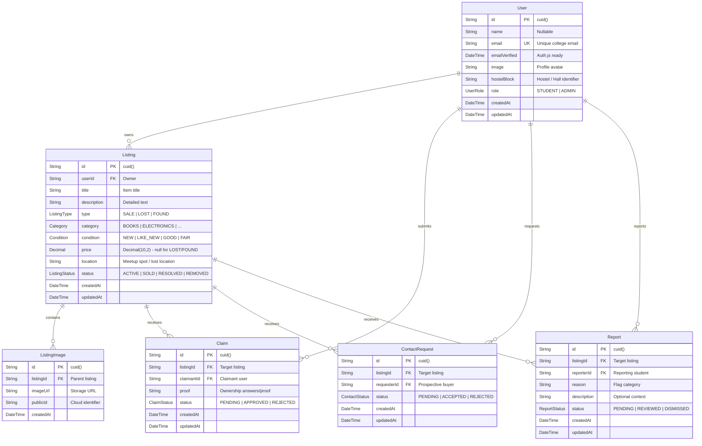

# Khoj — Database Design & Schema Documentation

## 1. Relational Entity Relationship Diagram

---

## 2. Table Specifications & Indexes

### `users`
Represents verified college students and administrators.
- **Constraints**: `email` UNIQUE.
- **Indexes**: Clustered on `id`, index on `email`.
- **Auth.js Compatibility**: Pre-configured with `emailVerified` and `image` to support zero-friction OAuth adapter migration.

### `listings`
Core multi-type listing table supporting Buy & Sell, Lost, and Found entries.
- **Foreign Keys**: `userId` references `users(id)` with `ON DELETE CASCADE`.
- **Indexes**:
  - `@@index([userId])` — Fast lookup for student dashboard & user profiles.
  - `@@index([type])` — Accelerated filtering by SALE, LOST, or FOUND.
  - `@@index([category])` — Category browsing (e.g., Books, Electronics).
  - `@@index([status])` — Active listing filtering (`status = 'ACTIVE'`).
  - `@@index([createdAt])` — Reverse-chronological timeline feeds.
- **Monetary Precision**: `price` is stored as `Decimal(10, 2)` to eliminate floating-point rounding errors.

### `listing_images`
Associated photos uploaded for listings.
- **Foreign Keys**: `listingId` references `listings(id)` with `ON DELETE CASCADE`.
- **Indexes**: `@@index([listingId])`.

### `claims`
Ownership claim submissions for LOST or FOUND items.
- **Foreign Keys**:
  - `listingId` references `listings(id)` with `ON DELETE CASCADE`.
  - `claimantId` references `users(id)` with `ON DELETE CASCADE`.
- **Constraints**: `@@unique([listingId, claimantId])` — Prevents duplicate spam claims by the same student on a single listing.
- **Indexes**: `@@index([listingId])`, `@@index([claimantId])`, `@@index([status])`.

### `contact_requests`
Private requests from interested buyers to sellers.
- **Foreign Keys**:
  - `listingId` references `listings(id)` with `ON DELETE CASCADE`.
  - `requesterId` references `users(id)` with `ON DELETE CASCADE`.
- **Constraints**: `@@unique([listingId, requesterId])` — Prevents repeated request spam.
- **Indexes**: `@@index([listingId])`, `@@index([requesterId])`, `@@index([status])`.

### `reports`
Student moderation flags for fraud, abuse, or prohibited items.
- **Foreign Keys**:
  - `listingId` references `listings(id)` with `ON DELETE CASCADE`.
  - `reporterId` references `users(id)` with `ON DELETE CASCADE`.
- **Constraints**: `@@unique([listingId, reporterId])` — Restricts each user to one active report per listing.
- **Indexes**: `@@index([listingId])`, `@@index([reporterId])`, `@@index([status])`.

---

## 3. Type-Specific Validation Invariants

| Field | `SALE` Type | `LOST` Type | `FOUND` Type |
| :--- | :--- | :--- | :--- |
| `price` | **Required** (Positive decimal) | **NULL** | **NULL** |
| `condition` | **Recommended** (NEW, LIKE_NEW, GOOD, FAIR) | Optional / Null | **Required** (Current retrieved condition) |
| `location` | Exchange Meetup Spot (e.g. Canteen, Library) | Last Misplaced Spot | Found Location or Secure Desk |
| `claims` | Disabled (Uses Contact Requests) | **Enabled** (Finder can verify) | **Enabled** (Owner can claim) |
| `contactRequests` | **Enabled** (Buyers initiate) | Disabled | Disabled |

---

## 4. Migration & Management Workflow

- **Migration Tool**: Prisma Migrate (v7.10.1).
- **Migration Location**: `prisma/migrations/20261126212211_init/migration.sql`.
- **Driver**: Neon Serverless driver adapter (`@prisma/adapter-neon`).
- **Connection**:
  - Migration CLI operations use `DIRECT_URL`.
  - Runtime app queries use `DATABASE_URL` pooler.
