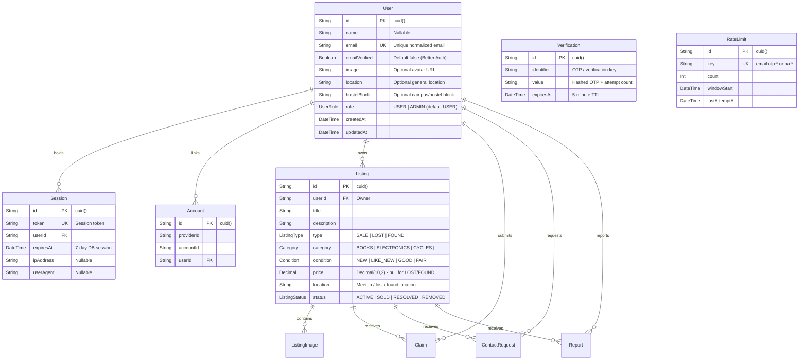

# Khoj — Database Design & Schema Documentation

## 1. Relational Entity Relationship Diagram



---

## 2. Table Specifications

### Authentication & Rate-Limiting Tables (Day 2)
- **`users`**: Public community users and administrators (`role`: `USER` | `ADMIN`). Any valid email address may register via 6-digit OTP verification; `hostelBlock` and `location` are optional profile fields.
- **`sessions`**: Database-backed 7-day sessions (`onDelete: Cascade` to `users`), indexed on `userId` and unique `token`.
- **`accounts`**: Better Auth account links (`@@unique([providerId, accountId])`, `onDelete: Cascade`).
- **`verifications`**: Stores hashed 6-digit OTP codes with 5-minute `expiresAt` and attempt counters (`identifier` indexed).
- **`rate_limits`**: Persistent PostgreSQL rate-limit counters keyed by unique `key`, updated atomically via `INSERT ... ON CONFLICT ("key") DO UPDATE`.

### Marketplace & Lost & Found Tables
- **`listings`**: Core `SALE`, `LOST`, and `FOUND` entries (`Decimal(10, 2)` for `price`, indexed on `userId`, `type`, `category`, `status`, `createdAt`). Day 3 Marketplace CRUD APIs strictly scope to `type = "SALE"`.
- **`listing_images`**: Associated Cloudinary images (`imageUrl`, server-generated `publicId`, `onDelete: Cascade`), bounded at 5 images per `ACTIVE` marketplace listing.
- **`claims`**: Ownership claims for `LOST`/`FOUND` items (`@@unique([listingId, claimantId])`) — CRUD planned for Day 4.
- **`contact_requests`**: Buyer-to-seller contact requests (`@@unique([listingId, requesterId])`) — planned for Day 5.
- **`reports`**: Community reports for suspicious or inappropriate listings (`@@unique([listingId, reporterId])`) — planned for Day 6.

---

## 3. Migrations & Existing-Data Risks

- **Applied Migrations:**
  1. `prisma/migrations/20261126212211_init/migration.sql` — Day 1 business tables (`users`, `listings`, `listing_images`, `claims`, `contact_requests`, `reports`).
  2. `prisma/migrations/20261127110932_add_authentication/migration.sql` — Adds `sessions`, `accounts`, `verifications`, `rate_limits`, adds `users.location`, switches `UserRole` from `STUDENT` to `USER`, and changes `users.emailVerified` to `BOOLEAN NOT NULL DEFAULT false`.
- **Deferred Additive Migrations (Post-Day 3 / Future Review):**
  - Proposed additive changes not yet applied to `prisma/schema.prisma`:
    ```sql
    -- 1. Durable server-side duplicate listing prevention across refreshes/retries
    ALTER TABLE "listings" ADD COLUMN "idempotencyKey" TEXT;
    CREATE UNIQUE INDEX "listings_userId_idempotencyKey_key" ON "listings"("userId", "idempotencyKey");

    -- 2. Optional negotiable pricing flag & composite marketplace feed index
    ALTER TABLE "listings" ADD COLUMN "isNegotiable" BOOLEAN NOT NULL DEFAULT false;
    CREATE INDEX "listings_type_status_createdAt_idx" ON "listings"("type", "status", "createdAt");
    ```
- **Migration Risks for Existing Databases:**
  - `20261127110932_add_authentication` runs `DROP COLUMN "emailVerified"` and `ADD COLUMN "emailVerified" BOOLEAN NOT NULL DEFAULT false`, which resets existing verification timestamps to `false` if run against populated Day 1 tables.
  - Converting `UserRole` casts `"role"::text::"UserRole_new"`, which fails if existing rows still hold `'STUDENT'` without first mapping `'STUDENT'` -> `'USER'`.
- **Configuration:**
  - `prisma.config.ts` uses `DIRECT_URL` for Prisma CLI migration commands.
  - `src/lib/prisma.ts` uses `DATABASE_URL` with `@prisma/adapter-neon` for pooled runtime queries.
