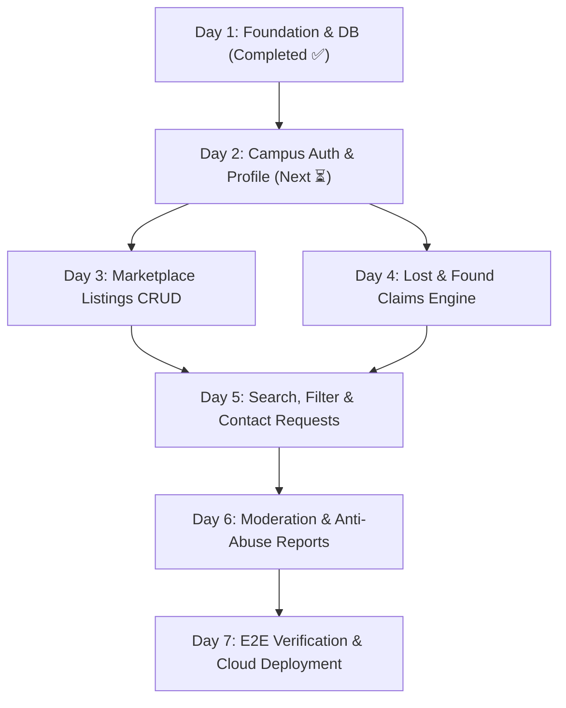

# Khoj — 7-Day Implementation Roadmap

> **Tagline:** Find it. Sell it. Reclaim it.
> **Target:** Production-grade campus marketplace and lost & found platform for verified college students.

---

## 📅 Roadmap Overview

---

## Daily Schedule & Deliverables

### Day 1: Project Foundation & Database Integration ✅ (COMPLETED)
- [x] Initialized Next.js 16 (Turbopack) with TypeScript and Tailwind CSS v4.
- [x] Installed and configured Prisma ORM (v7.10.1) with Neon Serverless driver adapter (`@prisma/adapter-neon`).
- [x] Implemented development-safe Prisma singleton in `src/lib/prisma.ts` with `server-only` barrier.
- [x] Designed relational schema supporting `User`, `Listing`, `ListingImage`, `Claim`, `ContactRequest`, and `Report`.
- [x] Applied initial migration `20261126212211_init` to Neon PostgreSQL.
- [x] Created `/api/health` monitoring endpoint (SELECT 1 verification).
- [x] Configured shadcn/ui components (`Button`, `Card`, `Input`, `Badge`, `Separator`, `Skeleton`).
- [x] Built responsive, mobile-first branded landing page and layouts.
- [x] Configured Vitest test suite with 17 passing unit tests (mocked DB, 0 DB dependency).
- [x] Verified zero database secrets exposed in Git or logs.

---

### Day 2: Campus Email Authentication & User Profile ⏳ (PLANNED)
- [ ] Integrate Auth.js (NextAuth v5) with institutional Google/Email magic links.
- [ ] Enforce allowed college email domain verification (`ALLOWED_EMAIL_DOMAINS`).
- [ ] Hostels & profile configuration (hostel block, phone/social handle privacy controls).
- [ ] Role-based access control (Student vs Admin session tokens).
- [ ] Session-aware navigation states and protected route middleware.

---

### Day 3: Marketplace Buy & Sell Engine ⏳ (PLANNED)
- [ ] Cloudinary integration for multi-image uploads with server-side validation.
- [ ] Listing creation form with Zod schema (title, description, category, condition, price, meetup location).
- [ ] Price validation invariants (positive numeric format, free/exchange option).
- [ ] Listing detail pages with image gallery and seller hostel block preview.
- [ ] Listing status state transitions (ACTIVE → SOLD → REMOVED).

---

### Day 4: Lost & Found Submissions & Verification ⏳ (PLANNED)
- [ ] Dedicated LOST and FOUND item post forms.
- [ ] Enforced zero-price invariants for lost/found items.
- [ ] Secret ownership proof questions (e.g., lock code, serial digits, unique scratches).
- [ ] Ownership claim submission workflow (`Claim` model integration).
- [ ] Finder dashboard to review, approve, or reject ownership claims.

---

### Day 5: Search, Filtering & Contact Handover ⏳ (PLANNED)
- [ ] Full-text search and category filtering (Books, Electronics, Cycles, Stationery, etc.).
- [ ] Filter by listing type (SALE, LOST, FOUND) and condition (New, Like New, Good, Fair).
- [ ] Private Contact Request workflow (prevents student phone number harvesting).
- [ ] In-app notification triggers when seller accepts contact request.
- [ ] Designated safe campus meetup locations picker.

---

### Day 6: Moderation, Anti-Abuse & Reports ⏳ (PLANNED)
- [ ] Listing report modal (`Report` model) for inappropriate or fraudulent items.
- [ ] Admin dashboard to review flagged listings, view reporter comments, and dismiss or remove listings.
- [ ] Rate limiting on listing creation, claim submissions, and contact requests.
- [ ] User suspension and moderation log audit trail.

---

### Day 7: End-to-End Verification, Performance & Cloud Deployment ⏳ (PLANNED)
- [ ] Comprehensive E2E test suite (Playwright/Vitest integration flows).
- [ ] Lighthouse mobile audits (accessibility, performance, SEO, best practices).
- [ ] Security audit: Content Security Policy, rate-limiting, CORS, and SQL injection barriers.
- [ ] Production build verification and Vercel cloud deployment.
- [ ] Production smoke testing and handover documentation.
