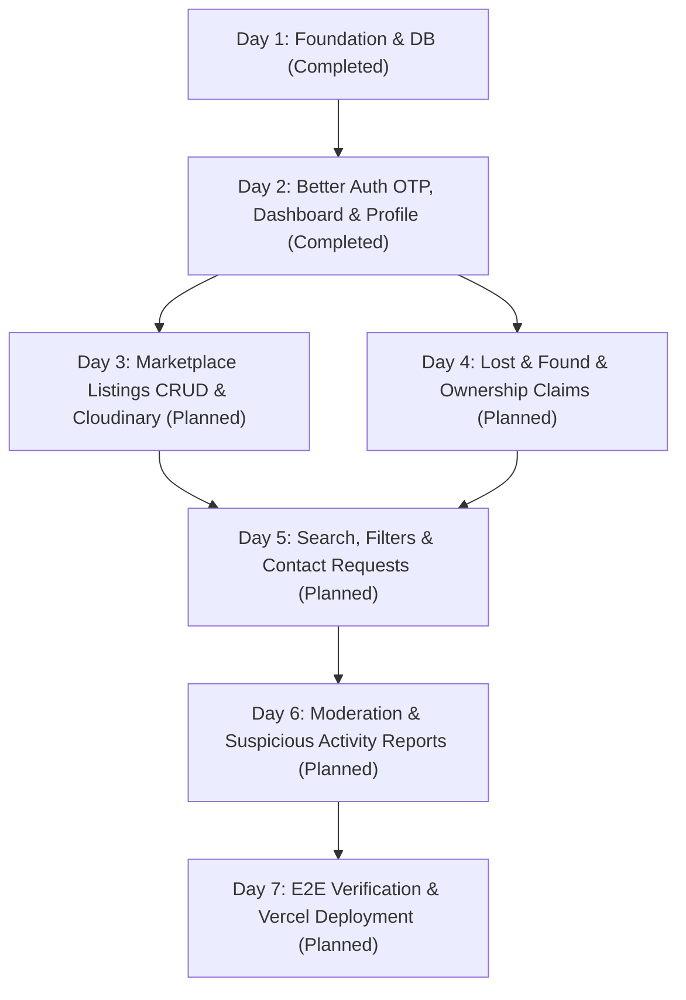

# Khoj — 7-Day Implementation Roadmap

> **Tagline:** Find it. Sell it. Reclaim it.
> **Scope:** Community marketplace and lost & found platform open to anyone with a valid email address (supporting local neighborhoods and campus communities).

---

## Roadmap Overview

---

## Daily Schedule & Deliverables

### Day 1: Project Foundation & Database Integration (COMPLETED)
- [x] Initialized Next.js 16 (Turbopack, Cache Components) with TypeScript and Tailwind CSS v4.
- [x] Configured Prisma ORM (v7.10.1) with `@prisma/adapter-neon` singleton (`src/lib/prisma.ts`).
- [x] Designed business models (`Listing`, `ListingImage`, `Claim`, `ContactRequest`, `Report`) and applied initial migration `20261126212211_init`.
- [x] Built `/api/health` (`SELECT 1`) and responsive branded landing page.

---

### Day 2: Public Email OTP Authentication, Dashboard & Profile (COMPLETED)
- [x] Integrated Better Auth (`1.7.28`) with the `emailOTP` plugin (6-digit OTP, 5-minute expiry, max 3 attempts, `resendStrategy: "rotate"`, `storeOTP: "hashed"`).
- [x] Configured Nodemailer Gmail SMTP transporter (`port 587`, `requireTLS: true`) — *live OTP delivery pending end-to-end verification after credential rotation*.
- [x] Implemented persistent atomic PostgreSQL rate limiting (`60s` cooldown, `5/hr/email`, `10/hr/IP` send, `20/hr/IP` verify).
- [x] Applied migration `20261127110932_add_authentication` (`Session`, `Account`, `Verification`, `RateLimit`, `USER` role default, boolean `emailVerified`, `location`).
- [x] Implemented `/login` and `/verify` passwordless UI, `/dashboard`, `/profile`, `/api/profile`, protected `/admin`, and session-aware `Navbar`.
- [x] Rebranded landing page and docs for public community use (retaining campus communities as an optional use case).

---

### Day 3: Marketplace Buy & Sell Engine (PLANNED)
- [ ] Cloudinary integration for multi-image listing uploads with server-side validation.
- [ ] Listing creation/edit/delete workflows with Zod validation (`SALE` price & condition invariants).
- [ ] Listing detail pages and status transitions (`ACTIVE` -> `SOLD` -> `REMOVED`).

---

### Day 4: Lost & Found & Ownership Claims (PLANNED)
- [ ] Dedicated `LOST` and `FOUND` listing creation flows (null price invariant).
- [ ] Ownership claim submission workflow (`Claim` model) and finder review actions (`APPROVED` / `REJECTED`).

---

### Day 5: Search, Filtering & Contact Requests (PLANNED)
- [ ] Search and filters by type (`SALE`, `LOST`, `FOUND`), category, condition, and location.
- [ ] Private `ContactRequest` handshake between buyers and sellers.

---

### Day 6: Moderation & Community Reporting (PLANNED)
- [ ] Listing report modal (`Report` model) to flag suspicious or inappropriate activity.
- [ ] Admin moderation queue in `/admin` to review, dismiss, or remove flagged listings.

---

### Day 7: E2E Verification & Deployment (PLANNED)
- [ ] End-to-end authentication & listing verification (including live Gmail SMTP testing).
- [ ] Security hardening (including keyed HMAC OTP hashing) and Vercel deployment.
