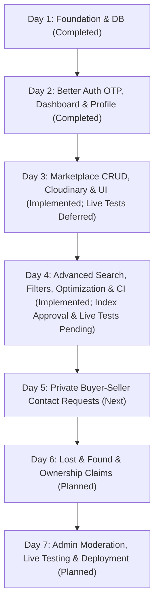

# Khoj — 7-Day Implementation Roadmap

> **Tagline:** Find it. Sell it. Reclaim it.
> **Scope:** Community marketplace and lost & found platform open to anyone with a valid email address (supporting local neighborhoods and campus communities).

---

## Roadmap Overview

---

## Daily Schedule & Deliverables

### Day 1: Project Foundation & Database Integration (COMPLETED)
- [x] Initialized Next.js 16 (Turbopack, Cache Components) with TypeScript and Tailwind CSS v4.
- [x] Configured Prisma ORM (v7.10.1) with `@prisma/adapter-neon` singleton (`src/lib/prisma.ts`).
- [x] Designed business models (`Listing`, `ListingImage`, `Claim`, `ContactRequest`, `Report`) and applied initial migration `20261126212211_init`.
- [x] Built `/api/health` (`SELECT 1`) and responsive branded landing page.

---

### Day 2: Public Email OTP Authentication, Dashboard & Profile (COMPLETED)
- [x] Integrated Better Auth (`1.7.28`) with the `emailOTP` plugin (6-digit OTP, 5-minute expiry, max 3 attempts, `resendStrategy: "rotate"`, keyed HMAC-SHA256 OTP hashing via `OTP_HASH_SECRET`).
- [x] Configured Nodemailer Gmail SMTP transporter (`port 587`, `requireTLS: true`) — *live OTP delivery pending end-to-end verification*.
- [x] Implemented persistent atomic PostgreSQL rate limiting (`60s` cooldown, `5/hr/email`, `10/hr/IP` send, `20/hr/IP` verify).
- [x] Applied migration `20261127110932_add_authentication` (`Session`, `Account`, `Verification`, `RateLimit`, `USER` role default, boolean `emailVerified`, `location`).
- [x] Implemented `/login` and `/verify` passwordless UI, `/dashboard`, `/profile`, `/api/profile`, protected `/admin`, and session-aware `Navbar`.
- [x] Rebranded landing page and docs for public community use (retaining campus communities as an optional use case).

---

### Day 3: Marketplace Buy & Sell Engine (IMPLEMENTED — Live Integration Deferred)
- [x] Marketplace REST CRUD APIs & service layer (`SALE`-scoped, `Serializable` ownership & status guards, seller privacy projections).
- [x] Cloudinary signed upload & deletion pipeline with `sharp` pixel decoding, decompression bomb cap (`25 MP`), metadata stripping, bounded streaming (`3 MiB`), and environment namespace isolation (`khoj/development|preview|production`).
- [x] Protected Create/Edit UI (`/marketplace/create`, `/marketplace/[id]/edit`), public browse (`/marketplace`), product details (`/marketplace/[id]`), and protected `/dashboard/listings`.
- [ ] Manual end-to-end verification against live Neon DB & Cloudinary (`docs/DAY3_TESTING_CHECKLIST.md`).

---

### Day 4: Advanced Search, Filters, Optimization & CI (IMPLEMENTED — Index Approval & Remote CI Pending)
- [x] **Phase A — Search Backend:** Strict `.strict()` Zod query validation (`q`, `category`, `condition`, `minPrice`, `maxPrice`, `location`, `sort`, `page`, `limit`) and deterministic tie-breaker sorting (`newest`, `oldest`, `price_asc`, `price_desc`).
- [x] **Phase B — Search & Filter UI:** Responsive `/marketplace` search bar (`400ms` debounce + `Enter`/Clear), Desktop left sidebar & Mobile Base UI `Sheet` filter drawer, applied filter chips, sorting selector, URL query synchronization, and footer category links.
- [x] **Phase C — Database Audit & Optimization:** Added lightweight card projection (`getPublicMarketplaceListingCards`), deterministic `getUserMarketplaceListings` ordering, benchmarking plan, and review-only index proposal (`docs/DAY4_INDEX_MIGRATION_PROPOSAL.sql`).
- [x] **Phase D — GitHub Actions CI:** Added `.github/workflows/ci.yml` (`Khoj CI`) with Node `22.14.0`, `npm ci`, `prisma generate`, `prisma validate`, `tsc --noEmit`, `lint`, `test`, and `build`.
- [ ] Approve and benchmark proposed PostgreSQL composite/`pg_trgm` indexes on Neon development branch, and verify first remote GitHub Actions CI run after push.

---

### Day 5: Private Buyer-Seller Contact Requests (PLANNED)
- [ ] `ContactRequest` submission workflow from `/marketplace/[id]` for authenticated buyers (`ACTIVE` `SALE` listings).
- [ ] Seller inbox & consent controls (`ACCEPTED` / `REJECTED`) with notification and privacy boundaries.

---

### Day 6: Lost & Found & Ownership Claims (PLANNED)
- [ ] Dedicated `LOST` and `FOUND` listing creation and discovery flows (null price invariant, isolated from `SALE` marketplace feeds).
- [ ] Ownership claim submission workflow (`Claim` model) and finder verification actions (`APPROVED` / `REJECTED`).

---

### Day 7: Admin Moderation, Live Testing & Deployment (PLANNED)
- [ ] Community listing reporting (`Report` model) and `/admin` moderation queue to review, dismiss, or remove flagged listings.
- [ ] Complete live Neon DB, Gmail SMTP, Cloudinary, browser E2E verification, and Vercel production deployment.
